<p align="center">
  
</p>

<h1 align="center">Free Quiz &amp; Poll</h1>

<p align="center">
  <b>Self-hosted, Wooclap-style live quizzes, polls and word clouds.</b><br />
  Participants join from their phones and answer <b>at their own pace</b> — no app, no account.
</p>

<p align="center">
  <a href="https://www.buymeacoffee.com/cmtrkr"></a>
</p>

<p align="center">
  
  
  
  
  
</p>

<p align="center">
  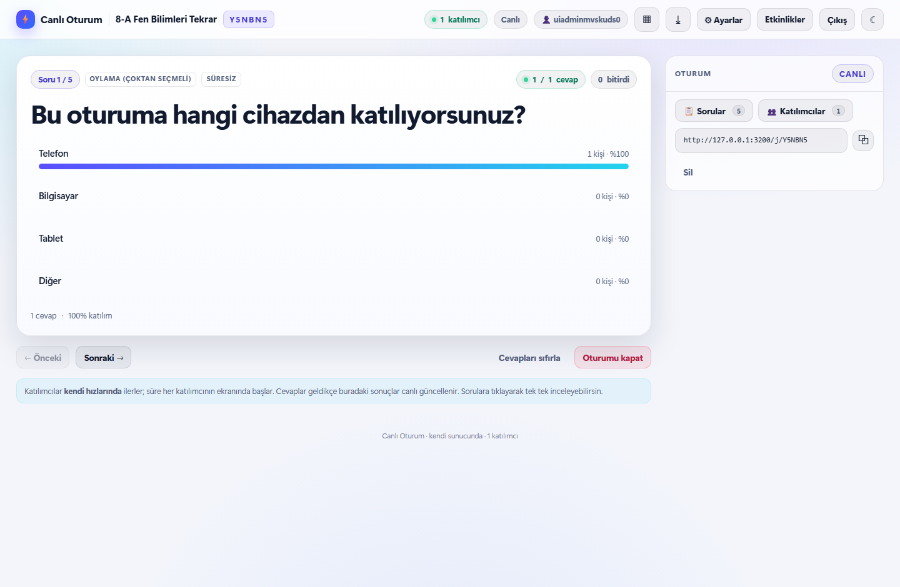
</p>

---

## Why another live quiz tool?

Most audience-response tools are SaaS: you pay per participant, and every answer leaves your
network. **Free Quiz & Poll** runs entirely on your own machine.

- **Self-paced by design.** Each participant gets their own timer on their own screen. Nobody waits
  for the host to click "next", and the host's previous/next buttons only change the host's view.
- **Instant feedback.** Results (and the correct answer in a quiz) appear as soon as a participant
  answers, or the moment their own timer runs out.
- **No participant accounts.** A QR code, a 6-character code, or a link is all they need.
- **Your data stays yours.** Everything lives in a single `data/db.json` file on your server.
- **Turkish UI, mobile-first, light/dark themes.** Built for classrooms and workshops.

## Features

| | |
| --- | --- |
| **Question types** | Multiple choice (single & multi-select), scored quiz, true/false, open-ended, word cloud, 1–5 rating |
| **Host accounts** | Registration/login with scrypt-hashed passwords and server-side session cookies |
| **Saved events** | Events belong to your account, can be reopened, renamed, or given a new code |
| **Join flow** | QR code (PNG/SVG), 6-character code or direct link; works on any modern phone browser |
| **Self-paced sessions** | Per-participant progress and timers; results on answer or timeout; completion screen with score |
| **Live results** | Animated bars, answer lists, word clouds and a leaderboard streamed over Socket.IO |
| **Quiz scoring** | Correct answer + speed relative to that participant's own timer; ranking computed server-side |
| **Host controls** | Start/close the session, browse questions, reset answers, clear participants, delete the event |
| **Export** | Participant answers and per-question summary as UTF-8 CSV (Excel/Sheets friendly) |
| **Resilience** | Participants return to the same question after a refresh; data survives server restarts |
| **Security** | CSP and security headers, rate limiting, optional registration key, legacy host-key links |
| **Themes** | Light/dark for both host and participant screens, remembered in the browser |
| **Zero build step** | Vanilla JS frontend, Express + Socket.IO backend, no bundler or framework |

## Screenshots

| Host dashboard | Join screen |
| --- | --- |
| 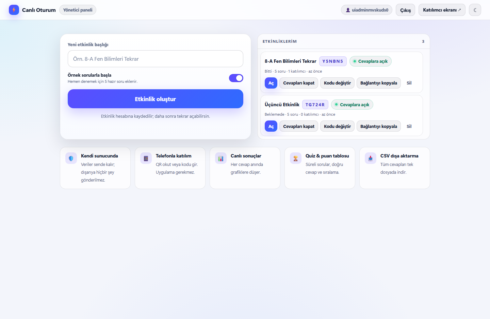 | 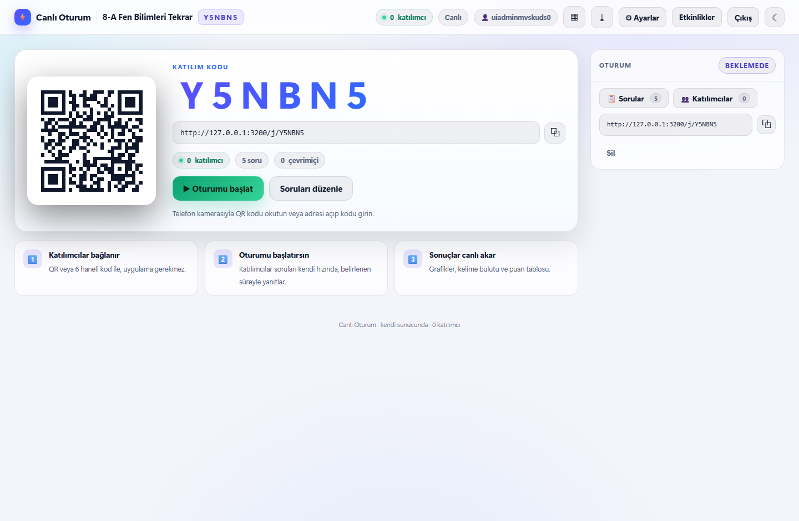 |

| Live results | Question editor |
| --- | --- |
|  | 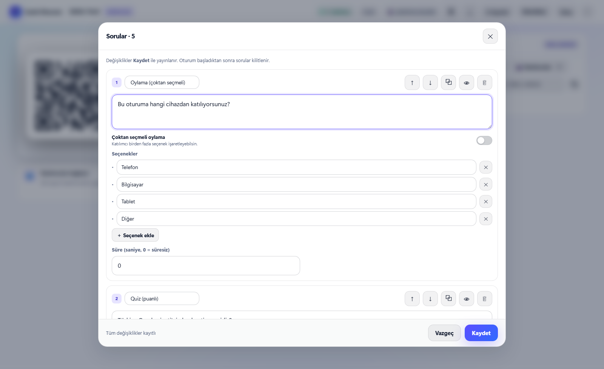 |

| Questions modal | Participants modal |
| --- | --- |
| 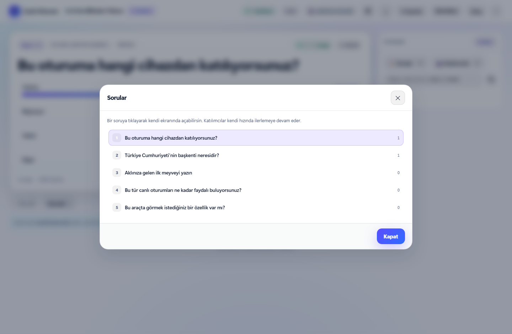 | 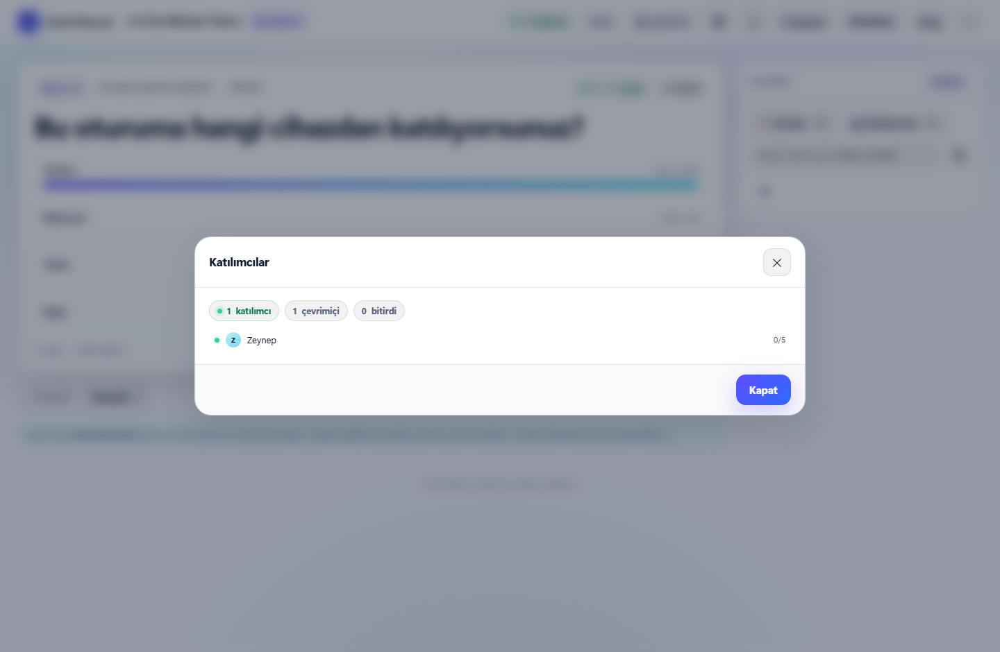 |

| Participant question | Results on the phone |
| --- | --- |
| 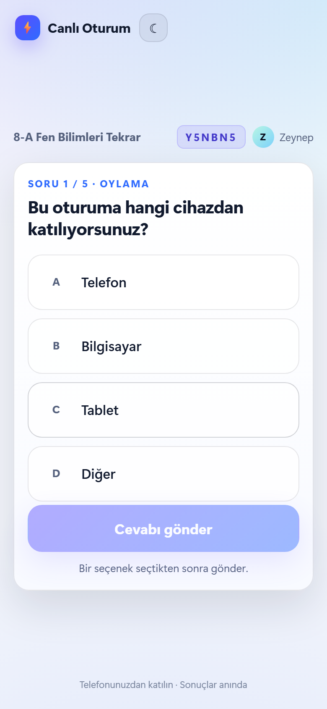 | 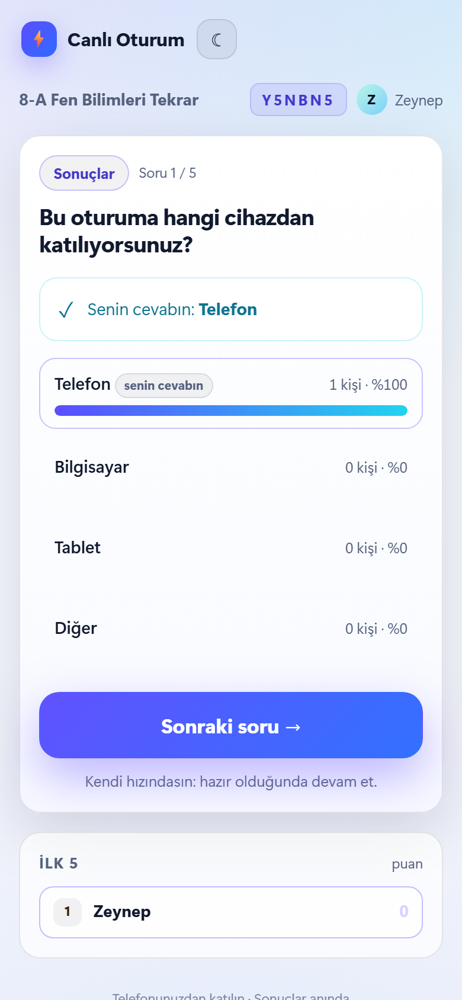 |

| Join from a phone | Completion screen |
| --- | --- |
| 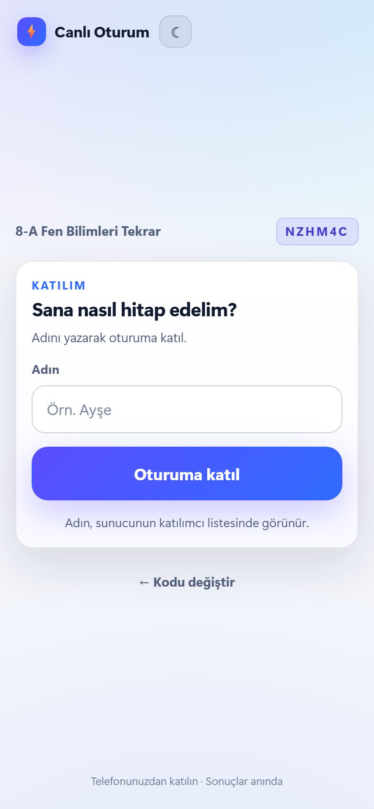 | 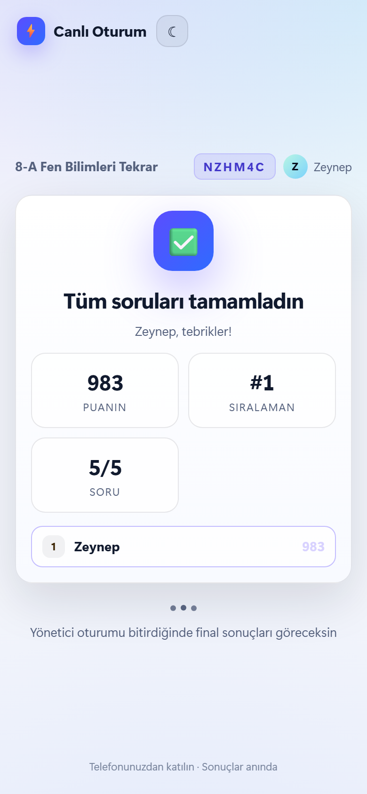 |

<p align="center">
  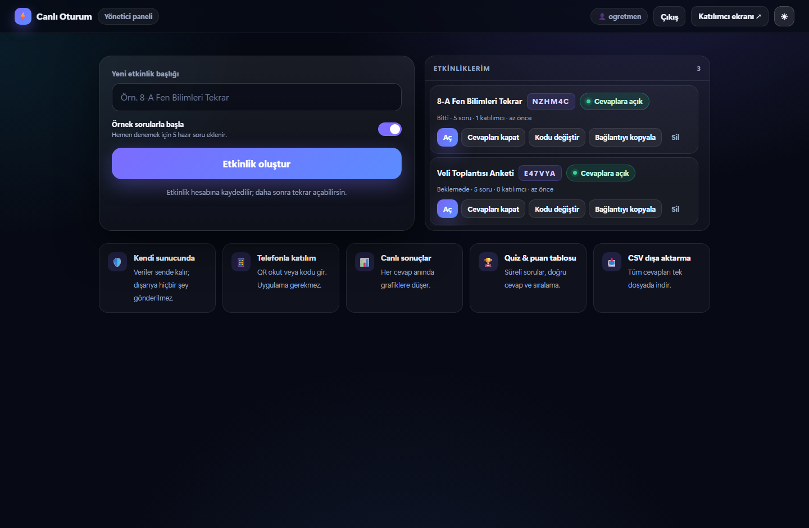
  <br />
  <sub>Light and dark themes are available on every screen.</sub>
</p>

## How a session works

```text
lobby  ──▶  live (self-paced)  ──▶  participant finished  ──▶  ended
             │
             ├─ each participant starts question 1 when they arrive
             ├─ the timer for a question starts on the participant's device
             ├─ answering (or the timer expiring) reveals the results immediately
             └─ the host can browse questions without moving anyone else
```

The host never gates the flow. When you click **Start**, every connected participant moves to
question 1; from there on, everyone advances through **Next question** on their own screen.

## Quick start

Requirements: **Node.js 20.19 or newer**.

```bash
git clone https://github.com/cmtrkr83/free-quiz-poll.git
cd free-quiz-poll
npm ci
cp .env.example .env      # Windows: Copy-Item .env.example .env
npm start
```

Then open:

- Host panel: <http://localhost:3000/host>
- Participant screen: <http://localhost:3000>

On first visit, create a host account (username + password of at least 8 characters). Create an
event, optionally with five demo questions, and share the QR code or the join link.

> `npm start` runs the app in the foreground. See [Run it 24/7](#run-it-247) to keep it running.

## Docker

```bash
cp .env.example .env       # set PUBLIC_URL and ADMIN_KEY first
docker compose up -d --build
```

- Panel: <http://localhost:3000/host>
- Logs: `docker compose logs -f app`
- Data volume: `canli-oturum-data` → `/data/db.json` inside the container
- Update: `docker compose up -d --build`
- Stop: `docker compose down` (data is kept)

## Configuration

Settings are read from environment variables. `npm start` loads `.env` from the project root,
and Docker Compose reads the same file.

| Variable | Default | Description |
| --- | --- | --- |
| `PORT` | `3000` | HTTP port |
| `HOST` | `0.0.0.0` | Bind address; use `127.0.0.1` for local-only |
| `DATA_DIR` | `./data` | Folder that contains `db.json` |
| `PUBLIC_URL` | empty | Public origin used in QR codes and links, e.g. `https://quiz.example.com`. Empty = request host |
| `ADMIN_KEY` | empty | If set, this key is required to register a new host account |
| `EVENT_TTL_DAYS` | `14` | Events older than this are deleted automatically (checked every 6 hours) |
| `MAX_EVENTS` | `500` | Maximum number of stored events |
| `TRUST_PROXY` | `1` | Set to `1` behind a reverse proxy / tunnel |

See [`.env.example`](./.env.example) for a commented template.

## Using it

### Host

Open `/h/CODE` (or `/host` for your event list).

- **Start / Close** — one button in the stage: green **Start session** while waiting, red
  **Close session** once live. Closing shows the final scoreboard to participants.
- **Settings** (⚙ in the top bar) — accept/stop responses, live results, leaderboard, close joining,
  rename, change code, export CSV.
- **Questions / Participants** — the two buttons in the session card open modal panels; picking a
  question only changes your own screen.
- **Reset answers** — clears answers for the selected question and restarts that question's timers.
- **Back to start** — returns to the lobby so you can edit questions; participants and answers stay.
- **New session** — resets participants, answers and scores.
- **Preview** (eye icon next to each question) — live preview of the participant's phone, updated
  while you type.

Keyboard shortcuts (when the panel is focused and you are not typing):

| Key | Action |
| --- | --- |
| `→` / `←` | Next / previous question on the host screen |
| `S` | Open settings |
| `E` | Open the question editor while in the lobby |

### Participants

1. Scan the QR code or enter the 6-character code.
2. Type a display name (remembered in the same browser).
3. Answer question 1 when the session starts; the timer is yours alone.
4. Results (and quiz feedback) appear immediately after answering.
5. Use **Next question** to move on; after the last question, see your score and completion screen.

Refreshing the page keeps the same participant identity and question. Late answers are rejected once
a participant's timer expires, and the results then open automatically.

## Share it on your LAN or the internet

**Same Wi-Fi (classroom):**

```powershell
ipconfig   # note the IPv4 address, e.g. 192.168.1.42
New-NetFirewallRule -DisplayName "Free Quiz Poll 3000" -Direction Inbound -Protocol TCP -LocalPort 3000 -Action Allow -Profile Private
```

Open the host panel through the LAN address — `http://192.168.1.42:3000/host` — so QR codes point
to an address phones can reach. Alternatively set `PUBLIC_URL`.

**HTTPS with a tunnel (Cloudflare example):**

```bash
cloudflared tunnel --url http://localhost:3000
```

Use the generated `https://….trycloudflare.com` address as `PUBLIC_URL` and restart. For a permanent
setup, use a named tunnel or a reverse proxy such as Caddy:

```text
quiz.example.com {
    reverse_proxy 127.0.0.1:3000
}
```

Nginx must forward WebSocket upgrades:

```nginx
location / {
    proxy_pass http://127.0.0.1:3000;
    proxy_http_version 1.1;
    proxy_set_header Upgrade $http_upgrade;
    proxy_set_header Connection "upgrade";
    proxy_set_header Host $host;
    proxy_set_header X-Forwarded-Proto $scheme;
    proxy_set_header X-Forwarded-For $proxy_add_x_forwarded_for;
}
```

> When the app is reachable from the internet, always set a strong `ADMIN_KEY`.

## Run it 24/7

- **Docker Compose** (recommended): `docker compose up -d --build`, container restarts automatically.
- **Windows service** with [NSSM](https://nssm.cc/): create a service that runs
  `node --env-file-if-exists=.env server.js` in the project folder.
- **PM2**: `pm2 start ecosystem.config.cjs && pm2 save`.
- **Linux systemd**: point `ExecStart` at `node --env-file-if-exists=.env /path/to/server.js` and
  restart on failure.

Health check: `GET /healthz` → `{"ok":true,"version":"1.0.0","uptime":123,"events":4}`

## Data, backups and retention

- Everything is stored in `data/db.json` (`/data/db.json` in Docker).
- Writes are batched every 400 ms and written atomically (`.tmp` → `db.json`).
- A corrupt database is backed up as `db.json.bozuk-<timestamp>` and the app starts empty.
- Backup: stop the app and copy `data/db.json`, or run
  `docker compose cp app:/data/db.json ./db-backup.json`.
- Restore: put the file back and restart.
- Events are deleted after `EVENT_TTL_DAYS`; export CSV first if you need a permanent archive.
- Backups contain participant names and answers — treat them as personal data.

## Tests

```bash
npm test          # API + Socket.IO end-to-end flow (node:test)
npm run test:ui   # Real browser UI flow (Puppeteer + Edge)
```

`test:ui` uses `C:\Program Files (x86)\Microsoft\Edge\Application\msedge.exe` by default. Set
`EDGE_PATH` or `CHROME_PATH` to use another browser. Screenshots are written to `test/shots/`.

## Project structure

```text
free-quiz-poll/
├─ server.js              # Express + Socket.IO server, API, QR, CSV
├─ src/
│  ├─ model.js            # Event model, validation, scoring, participant state
│  ├─ store.js            # Atomic JSON persistence
│  ├─ util.js             # IDs, text sanitising, rate limiting, password hashing
│  └─ demo.js             # Five-question Turkish demo event
├─ public/
│  ├─ index.html          # Participant app
│  ├─ host.html           # Host app
│  ├─ js/join.js          # Participant flow
│  ├─ js/host.js          # Host panel, editor, modals
│  └─ css/style.css       # Shared theme and responsive layout
├─ test/                  # API and browser tests
├─ docs/screenshots/      # README screenshots
├─ Dockerfile
├─ docker-compose.yml
├─ ecosystem.config.cjs
└─ .env.example
```

## API (overview)

| Method | Path | Description |
| --- | --- | --- |
| `GET` | `/healthz` | Health and version |
| `GET` | `/api/auth/config` | Whether registration is open and needs a key |
| `POST` | `/api/auth/register` | Create a host account (`username`, `password`, optional `adminKey`) |
| `POST` | `/api/auth/login` | Log in (`username`, `password`) |
| `GET` | `/api/account/events` | Events owned by the signed-in account |
| `POST` | `/api/events` | Create an event (`title`, optional `template: "demo"`) |
| `GET` | `/api/events/:code` | Public event summary |
| `GET` | `/api/events/:code/state` | Full host state (host auth) |
| `PUT` | `/api/events/:code` | Update title, questions or settings (host) |
| `POST` | `/api/events/:code/action` | `start`, `next`, `back`, `goto`, `end`, `restart`, `resetLobby`, `resetAnswers` (host) |
| `GET` | `/api/events/:code/qr.png` / `qr.svg` | Join QR code |
| `GET` | `/api/events/:code/export.csv?mode=summary` | CSV export (host) |
| `DELETE` | `/api/events/:code` | Delete an event (host) |

Host requests are authenticated with the session cookie. Legacy clients may send `?key=` or an
`x-host-key` header; `/h/CODE?k=HOSTKEY` links still work and keep the key in memory only.

## Security notes

- Passwords use scrypt; sessions are HTTP-only cookies backed by hashed tokens on the server.
- CSP, HSTS (behind HTTPS), frame and content-type protections are enabled by default.
- Registration and API calls are rate limited; set `ADMIN_KEY` before exposing the app publicly.
- The legacy host key travels in the URL. Do not show a host link on a projector or in screenshots.
- The app is single-process (in-memory state + one JSON file). Do not run multiple copies against the
  same `DATA_DIR`.

## Limitations

- Designed for one process and one shared `DATA_DIR`.
- Comfortable with hundreds of concurrent participants; very large events have not been stress-tested.
- Participant names are self-declared. Share links only with people you trust.
- No camera or microphone access; HTTPS is still recommended for public deployments.

## License

MIT © 2026 Cem Türker — see [LICENSE](LICENSE). You may use, modify and redistribute the app,
including commercially, as long as the copyright notice is kept.

## Support

If Free Quiz & Poll saves you a paid subscription, you can buy me a coffee:

<p align="center">
  <a href="https://www.buymeacoffee.com/cmtrkr"></a>
</p>

<p align="center">
  <sub>Türkçe dokümantasyon: <a href="README.tr.md">README.tr.md</a></sub>
</p>
